<p align="center">
  
</p>

<h1 align="center">Ariadne - Fintech Atlas</h1>

<p align="center">An explorable, source-backed map of how payments really move.</p>

<p align="center">Explore how money, messages and rules move through six markets, in 3D.</p>

<p align="center"><b>Live demo:</b> <a href="https://ariadne.surajvijayan.dev">https://ariadne.surajvijayan.dev</a></p>

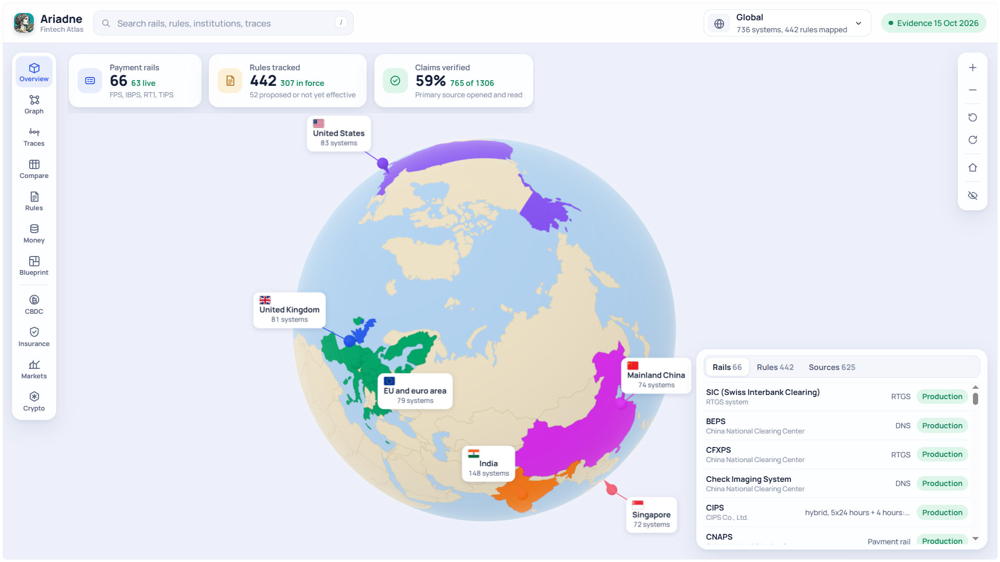

[Ariadne](https://en.wikipedia.org/wiki/Ariadne) is an interactive atlas of the systems behind everyday payments: the banks, central banks, payment rails, card schemes, regulators and rules that sit between "Pay" and "Paid". You can spin a globe, step into a 3D city for each of six markets, and follow one transaction from the payer's app to final settlement, with every claim linked to its source. It is for students, product people, engineers, policy readers and anyone curious about how money moves. The name comes from the myth: like Ariadne's thread through the Labyrinth, the traces follow one payment through banks, switches and rules.

For education and research, not legal or financial advice. Evidence as of 15 October 2026. The home page works on phones; the atlas itself is built for laptop and desktop screens.

## Contents

- [Take the tour](#take-the-tour)
  - [Home page](#home-page)
  - [Globe](#globe)
  - [Market cities and live traces](#market-cities-and-live-traces)
  - [Evidence behind every item](#evidence-behind-every-item)
  - [Transaction traces](#transaction-traces)
  - [Architecture graph](#architecture-graph)
  - [Country comparison](#country-comparison)
  - [Standards and rules](#standards-and-rules)
  - [Money types](#money-types)
  - [Product blueprints](#product-blueprints)
  - [CBDC and modules](#cbdc-and-modules)
- [Key ideas in plain words](#key-ideas-in-plain-words)
- [How the evidence works](#how-the-evidence-works)
- [What's covered](#whats-covered)
- [Using the atlas](#using-the-atlas)
- [For developers](#for-developers)
- [Updating the data and extending the atlas](#updating-the-data-and-extending-the-atlas)
- [Corrections and contributions](#corrections-and-contributions)
- [License](#license)
- [Acknowledgements](#acknowledgements)

## Take the tour

### Home page

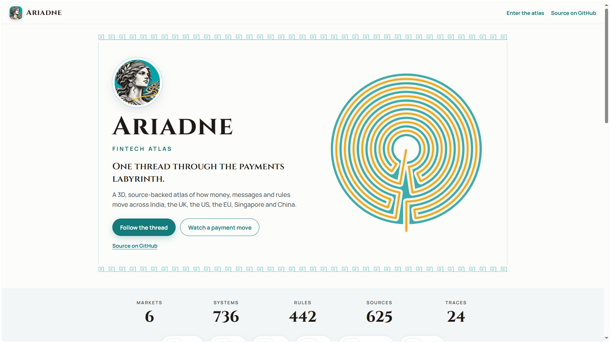

The front door. It shows the atlas in numbers, leads into each part of the atlas, tells the story of Ariadne's thread and explains why the project borrows it. It is the one page that also works on phones.

### Globe


The atlas opens on a slowly turning clay globe. The six markets are coloured in, each with a pin at its financial capital and a count of the systems mapped there. Click a pin, a label or a coloured country to fly into that market's city.

### Market cities and live traces

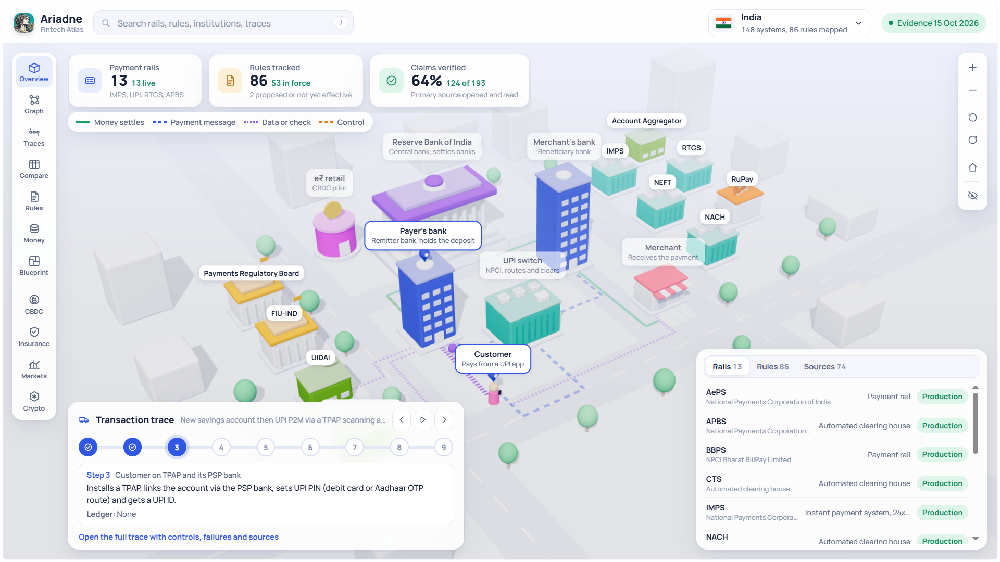

Each market is a small clay city. The buildings are real institutions and systems from the data, and coloured routes and moving vehicles act out that market's hero transaction one step at a time. Below the city, the trace card shows who acts at each step, on which system, and what happens to the ledger.

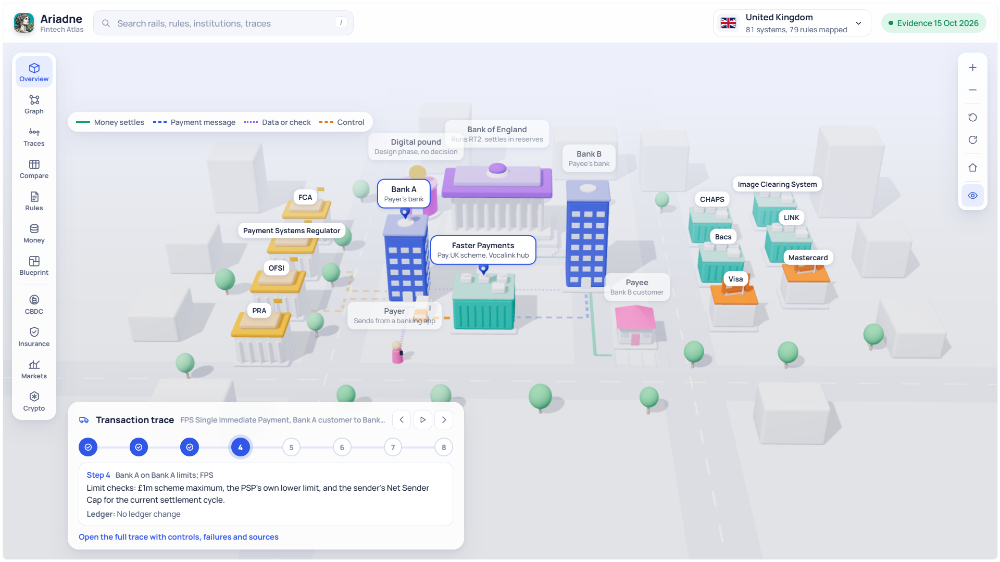

The eye button at the end of the map controls hides the key figures and the table when you just want to watch the city. The app remembers your choice.

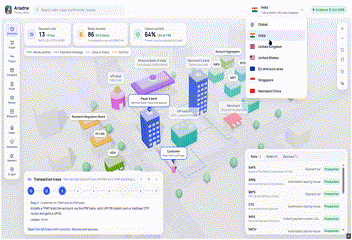

Switching from one city to another with the market menu plays a short trip: a ship between the UK and the EU, a plane everywhere else. Click or press any key to skip it.

### Evidence behind every item

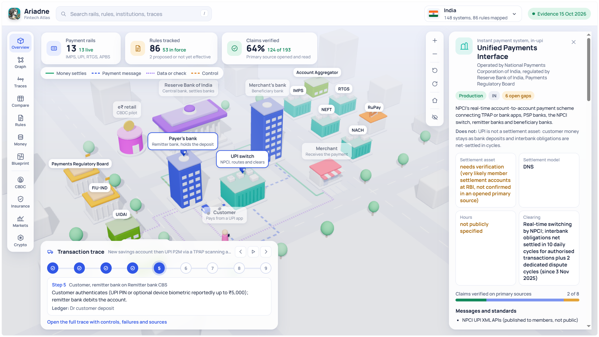

Select any building, chip or row to open its detail panel. It shows what the item is, who runs it, how it settles, the rules that apply, and every sourced claim with a label saying how well it is supported.

### Transaction traces

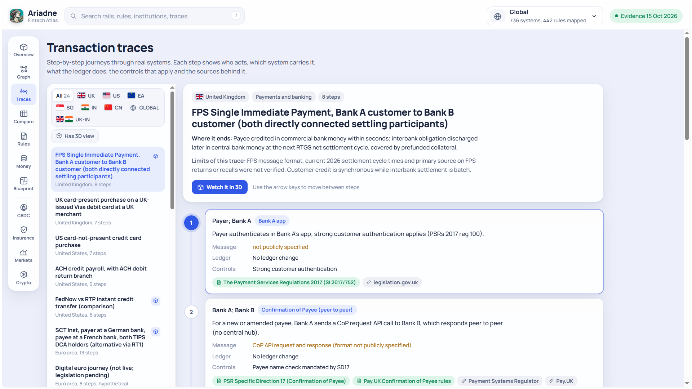

Traces are step-by-step journeys through real systems. Each step says who acts, which system carries it, what the ledger does, the controls that apply, what can fail and the sources behind it. Some traces include illustrative ledger entries, and a "Has 3D view" filter finds the ones you can watch in a city.

### Architecture graph

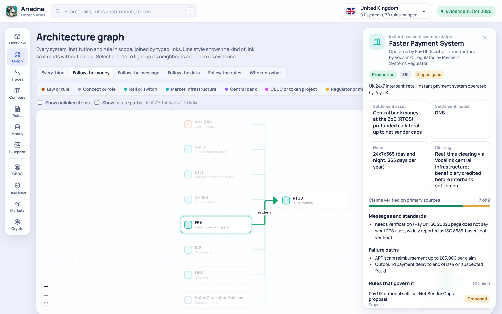

The graph joins every system, institution and rule in a market with typed links. Modes such as "Follow the money", "Follow the message", "Follow the data" and "Follow the rules" show one kind of link at a time, and line style shows the link type so it reads without colour.

### Country comparison

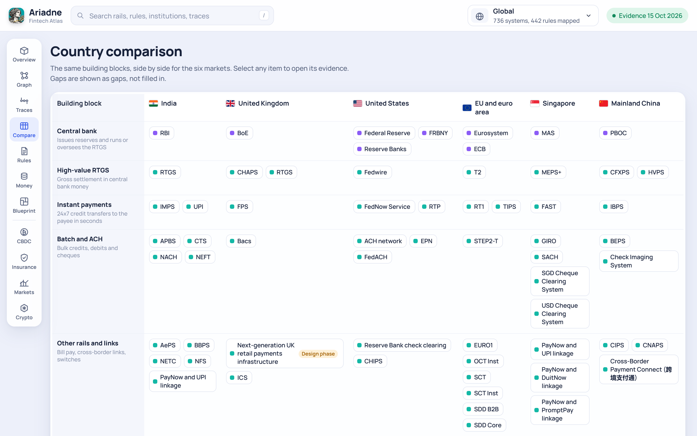

The same building blocks, side by side for the six markets: central bank, high-value and instant rails, card schemes, regulators, licence types, CBDC status, rules and evidence depth. Gaps are shown as gaps, not filled in.

### Standards and rules

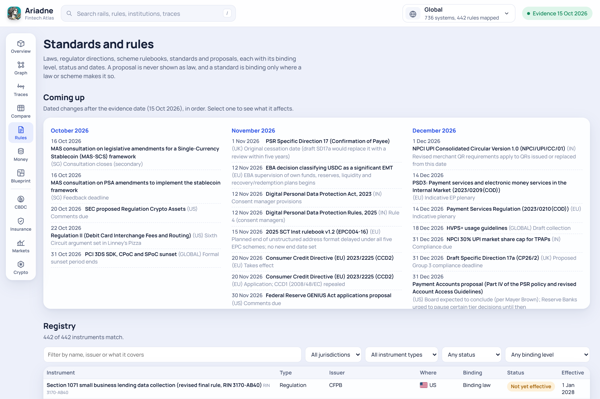

Laws, regulator directions, scheme rulebooks, standards and proposals, each with its binding level, status and dates. "Coming up" lists dated changes after the evidence date, month by month.

### Money types

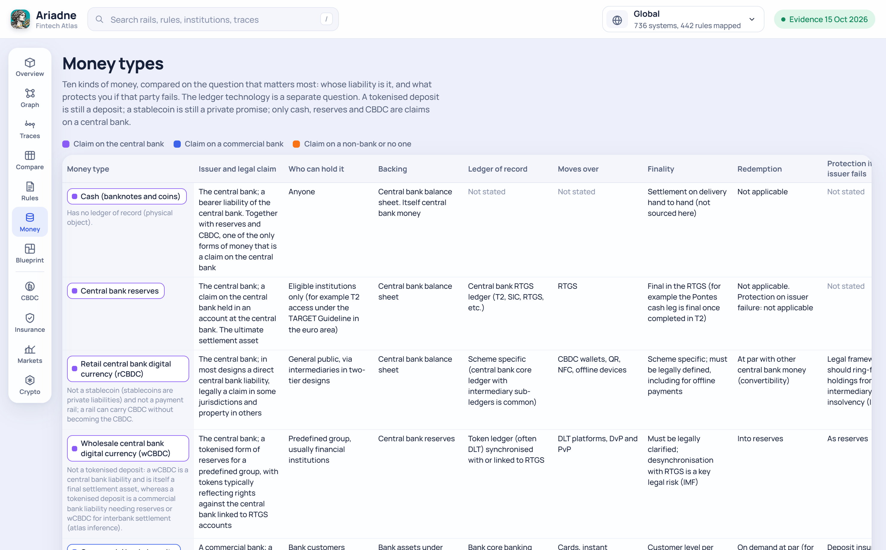

Ten kinds of money compared on the question that matters most: whose liability is it, and what protects you if that party fails. It also covers country-specific money and the CBDC in each market.

### Product blueprints

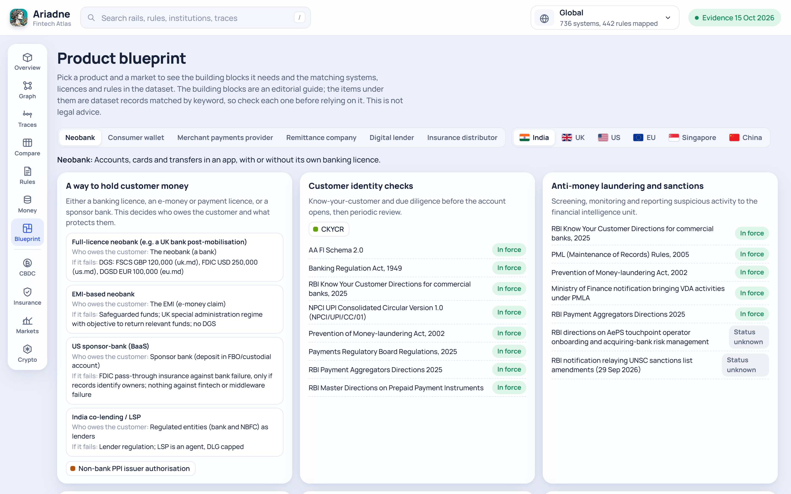

Pick a product (neobank, consumer wallet, merchant payments provider, remittance company, digital lender or insurance distributor) and a market to see the building blocks it needs and the matching records in the data. The blocks are an editorial guide and the matches are found by keyword, so check each one before relying on it.

### CBDC and modules

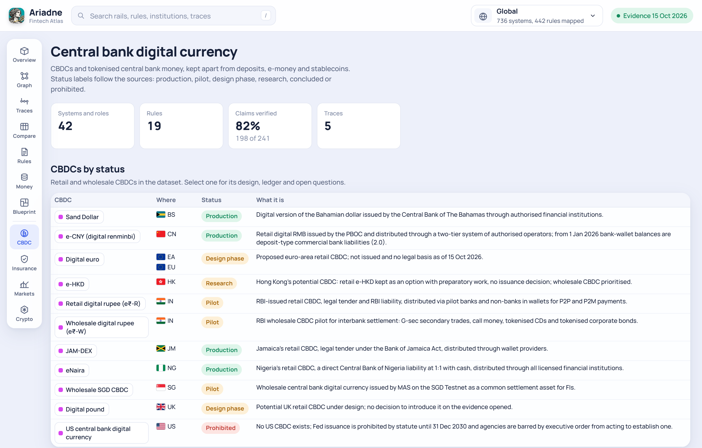

Module pages cover central bank digital currency, insurance, capital markets and crypto-assets. The CBDC page lists each CBDC by status, the projects and experiments, and the design choices every CBDC has to make.

## Key ideas in plain words

**Money, message and rule are different things.** A payment message is an instruction ("pay this account"). Settlement is when money actually moves between accounts, often between banks at the central bank. Rules and oversight sit around both: who may take part, what must be checked, and who supervises. The traces and the graph keep these apart.

**Every kind of money is someone's liability.** Cash, central bank reserves and CBDC are claims on a central bank. A bank deposit is a claim on a commercial bank. E-money, safeguarded balances and stablecoins are claims on a non-bank, and some crypto-assets are a claim on no one. What protects you if the issuer fails depends on which of these you hold.

**The ledger technology is a separate question.** A tokenised deposit is still a deposit. A stablecoin is still a private promise, never a CBDC. Only cash, reserves and CBDC are claims on a central bank.

**Status labels follow the sources.** Systems are labelled Production, Pilot, Design phase, Research, Concluded, Retired or Prohibited. Rules are In force, Not yet effective, Proposed, Consultation, Superseded or Stayed. A proposal is never shown as law, and a standard is binding only where a law or scheme rule makes it so.

## How the evidence works

Everything in the atlas comes from the evidence package in [`evidence/`](evidence/):

- **Claims** are single, checkable statements about a system, rule or trace step. Each claim cites one or more sources.
- **Sources** are the documents behind the claims: laws, regulator and central bank pages, scheme rulebooks, standards and analysis. The app marks each one as Primary (opened and read), Secondary (analysis by a third party) or Not opened.
- **Each claim has a label**, shown next to it in the detail panel:
  - **Verified**: checked on a primary source that was opened and read.
  - **Secondary**: backed by its sources but not marked as verified on a primary source. Often this is secondary analysis, or a primary document that was not opened.
  - **Needs verification**: not yet confirmed.
  - **Conflicting**: sources disagree.
- **As-of date**: the evidence was checked as of 15 October 2026. The rules timeline uses this date to decide what is "coming up".
- **Gaps stay visible.** Anything a source does not specify is shown as "Not stated", "Not publicly specified" or "Needs verification" rather than filled in. The dataset also records known conflicts and gaps explicitly.

## What's covered

Six markets, India, the United Kingdom, the United States, the EU and euro area, Singapore and Mainland China, plus global layers such as card networks, SWIFT, CLS, standards bodies and CBDC work.

Totals from [`evidence/manifest.json`](evidence/manifest.json):

| Item | Count |
| --- | ---: |
| Systems, institutions and other entities (nodes) | 737 (one is a placeholder, so the app shows 736) |
| Links between them (edges) | 705 |
| Rules and standards | 442 |
| Transaction traces (scenarios) | 24 |
| Sourced claims | 1,306 |
| Sources | 625 |
| Illustrative ledger entries | 35 |
| Recorded conflicts | 42 |
| Recorded gaps | 282 |

Claims by label: 765 Verified, 454 Secondary, 57 Needs verification, 30 Conflicting.

Per market, counted the way the app counts them (an item that applies to several markets counts in each):

| Market | Systems | Rules | Traces |
| --- | ---: | ---: | ---: |
| India | 148 | 86 | 4 |
| United Kingdom | 81 | 79 | 3 |
| United States | 83 | 92 | 6 |
| EU and euro area | 79 | 66 | 2 |
| Singapore | 72 | 27 | 2 |
| Mainland China | 74 | 24 | 2 |
| Global | 173 | 64 | 2 |

The other 3 traces are cross-border, from the UK to India.

## Using the atlas

- **Navigate** with the dock on the left (Overview, Graph, Traces, Compare, Rules, Money, Blueprint and the modules) and pick a market from the menu in the top bar.
- **Search** rails, rules, institutions and traces from the top bar. Press `/` to jump to the search box, use the arrow keys and Enter to pick a result.
- **Close** the detail panel or the search results with `Escape`.
- **On a city**, use the map controls to zoom, rotate and reset the view, and the eye button to hide or show the panels.
- **On a trace**, use the arrow keys (or `j` and `k`) to move between steps.
- **Home page on any screen, atlas on laptop or PC.** The home page works on phones. The atlas views show a short notice on phones asking you to open the same link on a larger screen.
- **Back to the start**: the Ariadne logo in the top bar opens the home page.

Every view has a link you can share:

| Route | View |
| --- | --- |
| `#home` (default; an empty or unknown link opens it) | Home page: the story of the name, the atlas in numbers and a way into each view |
| `#overview-global` | Clay globe with the six markets highlighted and a pin at each financial capital |
| `#overview-in`, `#overview-uk`, `#overview-us`, `#overview-eu`, `#overview-sg`, `#overview-cn` | 3D clay city per market with its hero transaction animated |
| `#traces`, `#trace-<scenario id>` | Step-by-step transaction traces with rules, sources and illustrative ledger entries |
| `#graph-<market>` | Architecture graph filtered by flow type and kind of institution |
| `#compare` | Market comparison matrix and rails side by side |
| `#rules` | Standards and rules registry with a dated "coming up" timeline |
| `#money` | Ten money types compared by issuer, claim, backing, finality and protection |
| `#blueprint-<product>` | What a product (neobank, wallet, merchant payments and others) has to plug into |
| `#module-cbdc`, `#module-insurance`, `#module-markets`, `#module-crypto` | Module pages |
| `#node-<id>` | Opens a system's detail panel |

## For developers

### Requirements

Node 22.12 or newer (the toolchain is Vite 8 and Vitest 5).

### Run, build, test

```bash
npm ci
npm run dev        # generates public/data first, then serves http://localhost:5173
npm run build      # data, type check, production build into dist/
npm test           # vitest: evidence schema, world integrity, routes, flags, traces filter, travel modes, home page, copy rules
```

`npm run build` writes `dist/`, a plain static site you can deploy anywhere. Optionally, `npm run build:artifact` also writes `artifact/`, the same build with the page skeleton stripped, for hosts that supply their own.

### Deployment

The live site at [ariadne.surajvijayan.dev](https://ariadne.surajvijayan.dev) is deployed by GitHub Actions with [`.github/workflows/deploy.yml`](.github/workflows/deploy.yml):

- **When:** every push to `main`, or by hand from the Actions tab (`workflow_dispatch`).
- **Build job:** checks out the repo, sets up Node 22 with the npm cache, then runs `npm ci`, `npm test` and `npm run build` (which also generates `public/data`). It uploads `dist/` as the Pages artifact. A failing test stops the deploy.
- **Deploy job:** publishes the artifact to the `github-pages` environment with `actions/deploy-pages`. Runs share one `pages` concurrency group and are not cancelled mid-deploy.

The Vite base is `./` and routes are hash tokens, so the same `dist/` works at the domain root, under a subpath, or from any static host.

**Custom domain.** `public/CNAME` records the domain, `ariadne.surajvijayan.dev`, and is copied into `dist/`. With Actions deployments, GitHub reads the domain from the repository settings rather than from that file, so the one-time setup is:

1. Repository **Settings > Pages**: set **Source** to **GitHub Actions**, and enter `ariadne.surajvijayan.dev` as the custom domain.
2. At the DNS provider for `surajvijayan.dev`: add a `CNAME` record for `ariadne` pointing to `its-me-sv.github.io`.
3. Once the certificate is issued, tick **Enforce HTTPS**.

### Tech stack

| Library | Why |
| --- | --- |
| [Vite](https://vitejs.dev) + TypeScript | Fast dev server, typed code and simple chunk splitting |
| [React](https://react.dev) 18 | UI components and views |
| [Three.js](https://threejs.org) + [React Three Fiber](https://docs.pmnd.rs/react-three-fiber) and drei | The clay cities and the globe, written as React components |
| [React Flow](https://reactflow.dev) + [ELK](https://eclipse.dev/elk/) (elkjs) | The architecture graph and its automatic layout |
| [Zustand](https://zustand.docs.pmnd.rs) | One small store for data, scope and selection |
| [MiniSearch](https://lucaong.github.io/minisearch/) | Client-side full-text search with prefix and fuzzy matching |
| d3-geo, topojson-client, world-atlas | Drawing country outlines onto the globe texture |
| [Vitest](https://vitest.dev) | Data integrity and unit tests |

### Project layout

```
evidence/              research dataset (nodes, edges, rules, scenarios, claims, sources, ...), schema.ts, LICENSE
scripts/build-data.ts  trims evidence/ into public/data/core.json and evidence.json
src/data/              types, Zustand store, indexes, search
src/router.ts          hash routes
src/world/             3D: worlds.ts (city layouts and step maps), Scene.tsx (clay buildings, routes, vehicles),
                       Globe.tsx (global view), travel.ts (plane or ship between cities)
src/views/             one file per view, plus Travel.tsx (the city-to-city transition)
src/ui/                top bar, dock, detail panel, flags, phone notice, shared bits, kind colours
tests/                 vitest suites
docs/screenshots/      images used in this README
```

### Architecture notes

- **Data pipeline.** `scripts/build-data.ts` reads `evidence/*.json` and writes `public/data/core.json` (loaded at startup) and `public/data/evidence.json` (claims and sources, loaded after first paint). It only trims, renames and indexes fields; it never adds facts. `npm run dev` and `npm run build` run it first.
- **Lazy chunks.** The first load is React, the store and the shell. Each view is its own chunk. three.js loads only on the 3D overview, d3-geo and the world map data only on the globe, and React Flow only on the graph.
- **Graph layout.** ELK runs in a Web Worker with results cached per filter set, so large graphs never freeze the page.
- **3D performance.** City scenes drop to 1x resolution on devices that cannot hold a smooth frame rate.
- **Home page.** Its chunk imports no 3D, graph or map code (a test walks its import graph to enforce this). It reads its numbers from a tiny `public/data/stats.json` written by the data build, so phones never download the full dataset. On laptops, once the browser is idle it prefetches the Overview chunk and the atlas data, and hovering or focusing a way into the atlas fetches the chunk at once, so entering feels instant.
- **Phones.** The home page works on phones. For every atlas view, the phone notice renders before the view, so phones never request the 3D or graph code.
- **Routes.** Plain hash tokens, so the app runs from any static host or subpath without server rewrites.

## Updating the data and extending the atlas

### Updating the data

1. Edit or replace the files in `evidence/`. Keep the shapes in `evidence/schema.ts`: every node, edge and rule should cite claim ids, and every claim a source id.
2. Run `npm run build`, or `npm run data` while `npm run dev` is running, then reload.
3. Run `npm test`. The world tests fail if a 3D building points at a node id that no longer exists, or a step map refers to a step a scenario no longer has.
4. When the evidence date moves, change `asOf` in `evidence/manifest.json`. The rules timeline uses it to decide what is "coming up".

### Adding a rail, institution or other system

Add a node to `evidence/nodes.json` (id, canonicalName, type, jurisdictions, status, purpose, claims) and its links to `evidence/edges.json` (from, to, verb, flowClass). It then appears in search, the graph, the comparison and detail panels automatically. Its colour comes from its type in `src/ui/kinds.ts`.

### Adding a rule

Add it to `evidence/rules.json` with instrumentType, bindingLevel, effectiveStatus, dates and `affects` (node ids). Proposals stay `proposed`. A standard is binding only through a law or scheme rule that references it.

### Adding a CBDC

Add a node with type `cbdc` (or `cbdc_project` for an experiment) and a status from the sources: production, pilot, design_phase, research, concluded or prohibited. Never type a stablecoin or tokenised deposit as a CBDC. It shows on the CBDC module, the money page and the market's comparison column.

### Adding a scenario (trace)

Add it to `evidence/scenarios.json` with numbered steps. Each step names the actors, the message or instruction, the rail, the settlement asset and claim ids. Ledger entries go in `evidence/journal-entries.json`, keyed by scenario and step.

### Adding a market

1. Add its nodes, edges, rules and scenarios with the new jurisdiction code, and a coverage record in `evidence/coverage.json`.
2. Add the code to `Jur` in `src/data/types.ts`, `JURS` in `src/data/store.ts`, `JUR_TOKENS` in `src/router.ts` and `MARKETS` in `src/ui/bits.tsx`. Add its flag code in `src/ui/flags.ts` if it is not a plain ISO code.
3. For a 3D city, add an entry to `WORLDS` in `src/world/worlds.ts`: a hero `scenarioId`, `buildings` (each in one slot, pointing at a real `nodeId` or carrying actor text) and a `steps` map from scenario step number to the slots in focus and the `PATHS` routes to animate.
4. For the globe, add a pin to `GLOBE_MARKETS` in `src/world/Globe.tsx` (capital latitude and longitude, colour and label offset) and the country's ISO numeric ids to `COUNTRY_MARKET`.
5. Run `npm test`.

### Copy rules

No em or en dashes in any user-facing text; a test enforces this for the main source files. Status labels follow the sources exactly.

## Corrections and contributions

Spotted something wrong or out of date? Please [open an issue](https://github.com/its-me-sv/ariadne-fintech-atlas/issues) with:

- the item id (it appears in the link, such as `#node-<id>` or `#trace-<id>`, and in the files in `evidence/`),
- what is wrong, and
- a link to the source that shows it.

Every fact in the atlas needs a source, so changes without one cannot be merged. Pull requests that update `evidence/` should keep the claim and source structure described above and pass `npm test`.

## License

- Code: MIT, see [LICENSE](LICENSE).
- Evidence dataset (`evidence/`): CC BY 4.0, see [evidence/LICENSE](evidence/LICENSE).
- Quoted excerpts and linked documents belong to their original publishers and are cited by source.
- Flag images are served by [flagcdn.com](https://flagcdn.com). Country outlines come from [world-atlas](https://github.com/topojson/world-atlas) (Natural Earth).
- The Ariadne logo and the files in `docs/brand/` are not covered by the MIT license. All rights reserved by Suraj Vijayan.

## Acknowledgements

- Country outlines: [world-atlas](https://github.com/topojson/world-atlas), built from [Natural Earth](https://www.naturalearthdata.com) data.
- Flags: [flagcdn.com](https://flagcdn.com).
- Built with [React](https://react.dev), [Three.js](https://threejs.org) and [React Three Fiber](https://docs.pmnd.rs/react-three-fiber), [React Flow](https://reactflow.dev), [ELK](https://eclipse.dev/elk/), [Zustand](https://zustand.docs.pmnd.rs), [MiniSearch](https://lucaong.github.io/minisearch/) and [Vite](https://vitejs.dev).
